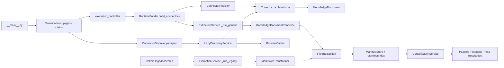
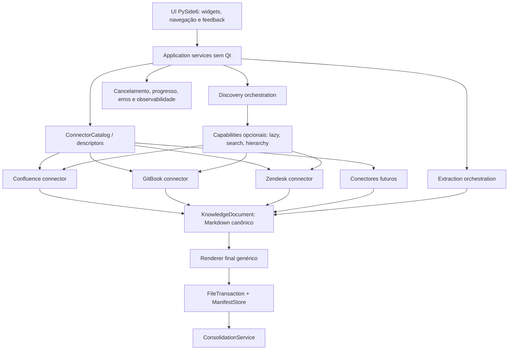

# Análise Arquitetural Definitiva — ALQuimista Studio 3.0

**Baseline:** worktree de 12/08/2026 sobre o commit `028914d7b768dd22f877067de8caf56e3028c3f8` (`main`).  
**Método:** consolidação de oito análises, auditoria independente `code-first`, validação de callers/imports e testes focados.  
**Escopo:** diagnóstico e recomendação. Nenhum código-fonte foi alterado para produzir esta análise.

## 1. Resumo executivo

O ALQuimista não precisa de reescrita. A base arquitetural necessária já existe: modelos comuns, registry de conectores, contrato compartilhado, pipeline genérico, transações de arquivos, manifesto incremental, consolidação, cancelamento e logging. O problema central é uma migração incompleta: a UI de produção já usa o pipeline genérico, mas partes importantes do comportamento ainda vivem no caminho legado do Confluence ou em decisões de plataforma espalhadas pela UI.

O achado mais crítico é funcional, não estético. A prévia e o pipeline legado usam `MarkdownTransformer`, que interpreta macros, links, anexos e opções do Confluence. A extração produtiva usa `ConfluenceRestConnector.normalize_document()` com conversão simples por `markdownify`, seguida de `KnowledgeDocumentRenderer`. Isso cria divergência entre a prévia e o arquivo realmente gerado e pode perder semântica de conteúdo. A coexistência de `_run_generic()` e `_run_legacy()` é dívida relevante, mas o ramo legado não é o fluxo normal da UI atual; removê-lo antes de congelar a paridade seria arriscado.

Também foram confirmados riscos de completude: a UI não consome `next_cursor` do discovery lazy, o Zendesk corta coleções em 5.000 itens sem sinalização e o runtime reinventa documentos antes de extrair uma seleção pequena. No pipeline genérico, falhas de `get_document()` podem abortar o lote inteiro e os fluxos de atualização parcial/repetição de falhas não preservam a mesma semântica do legado.

A arquitetura recomendada é incremental: parser específico por conector produz Markdown canônico em `KnowledgeDocument`; um renderer final genérico aplica metadados e opções comuns; casos de uso sem Qt orquestram discovery e execução; um catálogo único fornece status, capabilities, formulários e metadados visuais. Storage, manifesto, consolidação e runtime devem ser preservados e evoluídos apenas diante de defeito comprovado.

### Decisão principal

Antes de adicionar Notion, SharePoint ou Generic Web, o projeto deve:

1. congelar a saída atual com golden samples;
2. tornar o parser Confluence do pipeline genérico semanticamente equivalente ao comportamento escolhido;
3. unificar prévia e extração sobre o mesmo pipeline;
4. corrigir completude, isolamento de falhas e atualização parcial;
5. centralizar decisões de conectores no catálogo/capabilities.

Somente a divergência funcional de Markdown é P0 estrito. Os goldens são seu pré-requisito de aceitação, não um defeito independente. Os demais riscos foram calibrados como P1/P2 porque dependem de cardinalidade, ameaça local ou futura ativação de conectores.

## 2. Estado atual comprovado

### 2.1 Pipeline produtivo

O entrypoint oficial chama `run_app("complete")`. A `MainWindow` delega execução a `execution_controller`, que usa `RuntimeBuilder.build_connectors()`. Não há caller produtivo de `RuntimeBuilder.build()`; os callers encontrados estão em testes. `ExtractionService._run()` ainda despacha para `_run_legacy()` quando recebe runtimes sem conector, mas a UI atual não cria esse tipo de runtime.

### 2.2 Componentes saudáveis a preservar

- `FileTransaction`, confinamento de caminhos e escrita atômica;
- `ManifestStore` e `ManifestIndex`, respeitando compatibilidade de schema;
- `ConsolidationService`, que opera sobre manifesto e Markdown sem branches de plataforma;
- `CancellationToken`, rate limiting e workers baseados em `QThreadPool`;
- `RuntimeSecrets` e rejeição de segredos em `connector_options`;
- modelos `KnowledgeSource`, `KnowledgeContainer`, `KnowledgeDocumentMetadata` e `KnowledgeDocument`;
- registry/factory interno de conectores;
- cache de discovery limitado a metadados, após corrigir escopo e manutenção.

### 2.3 Hotspots atuais

| Hotspot | Evidência | Avaliação |
|---|---|---|
| `ui/main_window.py` | 3.170 linhas, 151 funções e 33 dependências internas na análise estática | Alto blast radius; dívida P2, não motivo para reescrita |
| `services.py` | 1.234 linhas e dois algoritmos de extração | Dívida P1, com diferenças funcionais confirmadas |
| `connectors/confluence.py` + `client.py` | Conector mais maduro, transporte e parser específicos | Deve ser estabilizado antes de unificação de HTTP |
| `markdown.py` | Dois caminhos de renderização com semânticas distintas | Problema funcional P0 |
| `ui/controllers.py` | Reconstrói inventário remoto antes de filtrar seleção | Risco de escala P1 |
| `connectors/base.py` | Métodos obrigatórios sem caller produtivo e capabilities paralelas | Dívida contratual P1/P2 |

Foi detectado um ciclo tardio `models.py → selection.py → models.py`, mitigado por import local. É dívida de fronteira, sem falha atual e sem prioridade para uma refatoração isolada.

## 3. Conclusões consolidadas das oito análises

### 3.1 Concordâncias fortes

As oito análises convergem nos seguintes pontos:

- evolução incremental, sem reescrita;
- existência de uma fundação extensível aproveitável;
- coexistência de pipeline genérico e legado;
- necessidade de proteger a saída do Confluence com goldens;
- parsing, discovery e paginação específicos por plataforma atrás de contratos comuns;
- renderer final, storage, manifesto, consolidação, logging, progresso e cancelamento compartilhados;
- `MainWindow` e `services.py` como hotspots;
- necessidade de testes comportamentais por conector;
- Generic Web como conector do pipeline existente, não modo especial do core;
- reorganização física e plugin framework somente quando houver necessidade comprovada.

### 3.2 Divergências resolvidas pelo código

| Tema | Posições dos relatórios | Veredito no worktree atual |
|---|---|---|
| Ramo legado é fluxo de produção | Parte o trata como pipeline produtivo equivalente; parte como compatibilidade | A UI usa somente `build_connectors()`; legado é compatibilidade/callers diretos e testes |
| `ExtractionService` genérico assume HTML | Algumas análises afirmam que sim | Refutado: recebe `KnowledgeDocument.content` e usa renderer genérico |
| Nova AST `CanonicalDocument` | Algumas propõem AST universal; outras preservam `KnowledgeDocument` | Prematura: `KnowledgeDocument` já é a fronteira canônica; primeiro explicitar que `content` é Markdown |
| Novo `DiscoveryService` | Metade do primeiro corpus propõe nova camada | Já existem `LazyDiscoveryService`, adapter e cache; o problema é integração/capabilities, não ausência de serviço |
| Funções duplicadas nos mixins/auth/controllers | Cinco relatórios repetem o achado | Obsoleto: AST não encontrou as redefinições citadas; `MAPA.md` está desatualizado |
| `TreeMixin` ativo | Relatórios mais antigos o tratam como fluxo real | Refutado: `MainWindow` não herda `TreeMixin`; implementações ativas estão na própria janela |
| `process_workers.py` produtivo | Um relatório alerta para processos zumbis | Refutado: somente testes o importam; produção usa `WorkerOperationController`/`QThreadPool` |
| Notion/SharePoint quase prontos | Relatórios divergem | Refutado: classes abstratas, `implemented=False`, paginação/modelos incompletos |
| Subpacotes por conector agora | Quatro a favor e quatro contra/condicionais | Adiar; tamanho por si só não justifica churn de imports |
| Unificar os clientes HTTP imediatamente | Alguns priorizam, outros adiam | Adiar até paridade, goldens e contrato de segurança; os dois clientes têm semânticas distintas |

### 3.3 Recomendações duplicadas consolidadas

As recomendações recorrentes “golden samples”, “contract tests”, “parser específico”, “pipeline único”, “capabilities na UI”, “reduzir `MainWindow`”, “completar Notion” e “Generic Web” foram reduzidas a uma única sequência no roadmap. Recomendações de mover arquivos, criar AST, criar plugin loader, criar event bus ou generalizar detectores foram classificadas como condicionais/prematuras.

## 4. Achados validados

### 4.1 Problemas reais

| ID | Problema | Evidência e impacto | Prioridade |
|---|---|---|---|
| R-01 | Confluence genérico não preserva a semântica do `MarkdownTransformer` | O conector usa `BeautifulSoup` + `markdownify`; macros `ac:*`, links `ri:*`, anexos e várias `MarkdownOptions` só são tratadas no legado | P0 |
| R-02 | Prévia não representa a extração produtiva | A prévia usa `MarkdownTransformer`; produção usa normalização do conector + `KnowledgeDocumentRenderer` | P0 com R-01 |
| R-03 | UI descarta continuação do discovery lazy | O conector retorna `next_cursor`, mas não há consumidor de `next_cursor`/`has_more` em `alquimista/ui` | P1 alto para completude |
| R-04 | Zendesk corta coleções em 5.000 itens silenciosamente | `_paged()` retorna o prefixo sem erro ou marcador de incompletude | P1 alto para completude |
| R-05 | Falha em `get_document()` pode abortar todo o lote genérico | A chamada ocorre antes do `try` que converte falhas em `FAILED`/`PRESERVED_AFTER_ERROR` | P1 alto |
| R-06 | Atualização parcial é ignorada na reconciliação genérica | `partial_update_keys` só é consultado no ramo legado | P1 alto |
| R-07 | “Repetir falhas” não restringe seleções estruturadas | Muta `selected_page_ids`, mas `ProjectConfig.selections` é autoritativo no schema atual | P1 alto |
| R-08 | Cache autenticado não isola identidades | Escopo usa somente `source.id` + modo de autenticação; logout/troca de conta não purga snapshots | P1 segurança/privacidade |
| R-09 | URLs absolutas fornecidas pela API podem reutilizar sessão autenticada | `ApiHttpClient` e `ConfluenceClient` aceitam URLs absolutas sem exigir mesma origem/HTTPS antes de nova requisição | P2 hardening; P1 se a política exigir same-origin |
| R-10 | Runtime redescobre inventário antes da extração | `build_connectors()` lista contêineres e documentos para só então filtrar chaves selecionadas | P1 escala |
| R-11 | UI possui whitelists funcionais e fallback Confluence | Três listas de tipos ativos orientam discovery em vez do registry/capabilities | P2; bloqueia ativação futura, mas cobre os três conectores atuais |
| R-12 | Fallback de auth seleciona browser, não público | `_auth_mode_changed()` procura `AuthMode.BROWSER` no caminho de recuperação de URL insegura | P2 bug localizado |
| R-13 | CI Windows pode mascarar o primeiro comando de um bloco | `ruff`/`mypy` e `compileall`/`pytest` compartilham blocos PowerShell sem checagem intermediária de exit code | P1 confiabilidade |

R-03 e R-04 dependem de cardinalidades elevadas, mas produzem omissão silenciosa quando o limite é alcançado; por isso são problemas de completude P1, não meras otimizações. Devem virar release blockers se existirem bases suportadas acima desses limites ou requisito formal de extração completa sem teto.

### 4.2 Dívida técnica

| ID | Dívida | Tratamento recomendado |
|---|---|---|
| D-01 | Dois algoritmos de extração | Manter temporariamente como especificação de compatibilidade; remover após paridade e migração dos testes |
| D-02 | `MainWindow` concentra UI, discovery e casos de uso | Extrair um caso de uso por vez, sem trocar framework ou reescrever telas |
| D-03 | ABC amplo e capabilities com três fontes | Contrato mínimo obrigatório e protocolos/capabilities opcionais comprovados por teste |
| D-04 | `ConfluenceClient` e `ApiHttpClient` duplicam transporte | Unificar apenas depois da estabilização funcional e de segurança |
| D-05 | Hierarquia de erros mistura categoria e plataforma | Criar erros neutros e aliases compatíveis; UI deriva o nome do contexto |
| D-06 | `ManifestEntry` mantém nomes Confluence | Preservar schema; migrar somente quando um requisito multiconector exigir |
| D-07 | Cache expira sem limpeza automática e faz consultas N+1 | Limpeza/quota e leitura em lote após corrigir completude/segurança |
| D-08 | Código inativo (`TreeMixin`, `page_registry.py`, `process_workers.py`, `_adapt_legacy_runtimes`, `_download_compat`) | Decidir explicitamente entre remover ou integrar, em mudanças separadas |
| D-09 | `KnowledgeDocument.content` não declara seu formato | Formalizar semanticamente como Markdown canônico sem introduzir AST |
| D-10 | Observabilidade pouco estruturada | Adicionar contexto de execução incrementalmente, preservando logging atual |

### 4.3 Melhorias desejáveis

- métricas de duração, tentativas, cache hit/miss e cardinalidade por etapa;
- conformance kit parametrizado para conectores ativos;
- testes de UI para troca de identidade, continuação lazy e mensagens neutras;
- política de quota/LRU do cache;
- catálogo de conectores também como fonte de metadados visuais e formulários;
- documentação gerada/validada a partir do catálogo e do contrato.

### 4.4 Otimizações e abstrações prematuras

Não fazer agora:

- AST universal `CanonicalDocument/CanonicalBlock`;
- plugin loader externo, SDK público, DI framework ou event bus;
- motor universal que interprete cursores de APIs;
- subpacote simétrico para todo conector;
- reescrita da `MainWindow` ou troca do PySide6;
- generalização do detector de URLs sem crescimento comprovado;
- otimização algorítmica ampla sem benchmark de cardinalidade/latência/memória;
- Generic Web antes de estabilizar Confluence e um segundo conector difícil.

## 5. Avaliação por dimensão

| Dimensão | Estado | Diagnóstico |
|---|---|---|
| Arquitetura | Intermediária | Fronteiras úteis existem, mas a migração está incompleta |
| Modularidade | Média | Conectores e infraestrutura são separados; UI e serviço de extração concentram decisões |
| Acoplamento | Médio-alto | `MainWindow` tem 33 dependências internas e conhecimento de plataformas |
| Conectores | Heterogêneo | Confluence, GitBook e Zendesk são concretos; Notion/SharePoint são protótipos bloqueados |
| Regressões | Frágil em Markdown | Boa cobertura sintética, mas sem goldens completos e com preview divergente |
| Testes | Razoável, desigual | Core possui boa cobertura; contratos, limites, segurança e UI assíncrona têm lacunas |
| Escalabilidade | Limitada por inventário | Lazy existe para Confluence, mas cursores e snapshots não atravessam todo o fluxo |
| Manutenção | Média-baixa | Código inativo, dois pipelines e metadata espalhada elevam custo de mudança |

### Maturidade dos conectores

| Conector | Estado real | Discovery | Conteúdo | Decisão |
|---|---|---|---|---|
| Confluence | Disponível/referência | Lazy roots/children/search, com continuação não consumida | Conversão genérica sem paridade com legado | Estabilizar primeiro |
| GitBook | Disponível | Inventário integral; pagina espaços e achata hierarquia | Markdown nativo | Manter e incluir no conformance kit |
| Zendesk | Disponível | Paginação por cursor, com cap silencioso | HTML→Markdown | Corrigir completude e testar limites |
| Notion | Desenvolvimento, abstrato | Primeira página e blocos incompletos | Conversão parcial | Não ativar; candidato a segundo conector difícil |
| SharePoint | Desenvolvimento, abstrato | Paginação/recursão incompletas | Binário tratado como UTF-8 | Não ativar; revisar escopo antes de completar |

## 6. Arquitetura recomendada

### 6.1 Fronteiras e dependências

| Fronteira | Responsabilidade | Pode depender de | Não deve conhecer |
|---|---|---|---|
| UI | apresentação, navegação, sinais e feedback | casos de uso, view state | endpoints, cursores, CQL, parsing de plataforma |
| Aplicação | orquestrar discovery, seleção, extração e retry | contratos, catálogo, storage | widgets Qt e payloads nativos |
| Catálogo | factory, status, auth, capabilities, formulário e metadata visual | tipos de contrato | estado de widgets |
| Conector | autenticação/adaptação, paginação, discovery, parsing e canonicalização | HTTP/browser e modelos comuns | manifesto, consolidação e UI |
| Core de extração | incremental, isolamento de falhas, renderer e relatório | `KnowledgeDocument`, runtime, storage | `source_type` e formatos nativos |
| Infraestrutura | HTTP seguro, cache, storage, logging | modelos técnicos | decisões de produto por plataforma |

### 6.2 Contrato recomendado

Preservar como núcleo obrigatório:

- lifecycle (`close`/context manager);
- `validate_connection()`;
- `list_containers()`;
- `list_documents(container_id)` enquanto necessário para compatibilidade;
- `get_document(document_id, container_id=...)` retornando `KnowledgeDocument` com Markdown canônico.

Tornar opcionais e explicitamente anunciados:

- roots/children lazy;
- busca remota;
- hierarquia direta;
- anexos/download;
- descoberta incremental/removal scan.

`get_source_type()` e `get_capabilities()` não devem continuar como obrigações redundantes se catálogo/classe já fornecem essa informação. A mudança deve ser compatível e precedida de matriz método × caller × conector.

### 6.3 Decisão sobre Markdown

O parser da plataforma deve converter o payload nativo para Markdown canônico. O renderer compartilhado aplica título, frontmatter, campos comuns, marcadores e hash. Regras como macros Confluence pertencem ao parser Confluence; o renderer não seleciona strategy por `source_type`.

As opções devem ser separadas por responsabilidade: imagens, anexos, macros, links, tabelas e painéis orientam o parser; título, metadados, traceability, marcadores e hash orientam o renderer. Depois que HTML/blocos viram Markdown destrutivamente, o renderer não consegue recuperar estrutura removida.

A prévia deve usar exatamente o mesmo parser e renderer da extração, com um payload fixture, evitando uma terceira implementação.

### 6.4 Teste mental de extensibilidade

- **Google Drive:** novo conector implementa discovery/paginação Graph/Drive e converte Docs/arquivos suportados para Markdown; core e UI não recebem branches de plataforma.
- **Generic Web:** conector próprio começa com uma página HTML estática, limites e canonicalização; browser é detalhe opcional do conector.
- **Notion com nova paginação:** somente adapter/conector Notion interpreta o cursor opaco; envelopes e casos de uso permanecem estáveis.
- **Mudança global de Markdown:** apenas renderer/opções/goldens comuns mudam; parsers de plataforma continuam responsáveis por semântica nativa.

## 7. Roadmap recomendado

### P0 — Recuperar paridade do Markdown produtivo

| Item | Objetivo | Esforço | Risco | Critério de conclusão |
|---|---|---:|---:|---|
| P0.1 Baseline obrigatório | Congelar payload, Markdown final, manifesto e hash de Confluence; incluir casos representativos de GitBook/Zendesk | M | Baixo | Fixtures cobrem macros, links, anexos, tabelas, hierarquia e flags on/off |
| P0.2 Parser e renderer únicos | Levar a semântica aprovada ao parser Confluence genérico e fazer preview/extração usarem o mesmo pipeline | L | Alto | Goldens passam; preview e arquivo são equivalentes; nenhuma branch Confluence no renderer final |

### P1 — Confiabilidade, segurança e escalabilidade operacional

| Item | Dependência | Esforço | Critério de conclusão |
|---|---|---:|---|
| P1.1 Isolar falha por documento | P0.1 | M | `get_document()` falho não aborta outros documentos; relatório/manifesto preservam erro individual |
| P1.2 Corrigir retry parcial | P0.1 | M | `partial_update_keys` funciona no genérico e “Repetir falhas” altera a seleção estruturada correta |
| P1.3 Unificar semântica do manifesto | P1.2 | M | source disabled/removed, unselected, cleanup e remote removal têm testes comuns nos dois caminhos |
| P1.4 Continuação e limites explícitos | Nenhuma | M | UI consome cursor/avisa limite; Zendesk falha ou sinaliza truncamento; testes excedem os budgets |
| P1.5 Reutilizar snapshot selecionado | P0.1 | L | extração pequena não reinventa a coleção inteira; removal scan é fase explícita |
| P1.6 Isolar cache autenticado | Nenhuma | M | identidade/sessão separa snapshots e logout/troca de conta purga ou rotaciona o escopo |
| P1.7 Tornar CI fail-fast | Nenhuma | S | cada comando nativo propaga exit code e a matriz roda no Python 3.12 |

### P2 — Redução sustentável de dívida

| Item | Dependência | Esforço | Critério de conclusão |
|---|---|---:|---|
| P2.1 Catálogo único + contrato mínimo | P0.1 | L | whitelists funcionais somem; conformance kit valida catálogo/capabilities e os três conectores ativos |
| P2.2 Casos de uso sem Qt | P1.1/P2.1 | L contínuo | um fluxo por vez sai da `MainWindow`, mantendo sinais e comportamento |
| P2.3 Remover/integrar código inativo | Goldens/testes afetados | M | decisão explícita para `TreeMixin`, `page_registry`, `process_workers` e adapters mortos |
| P2.4 Erros neutros e observabilidade | P1.1 | M | UI usa contexto da fonte; logs possuem run/source/document/stage sem segredos |
| P2.5 Hardening de HTTP, sessão e cache | P1.6 | M | same-origin/HTTPS, fallback DPAPI seguro, limpeza/quota e leitura em lote possuem testes |
| P2.6 Completar Notion como prova | P2.1 | L/XL | classe concreta, paginação/blocos completos, goldens e conformance kit sem mudanças específicas no core |

### P3 — Expansão condicionada

- completar SharePoint após definir tipos de arquivo suportados e download/conversão;
- implementar Generic Web v1 como conector de página única, com proteção SSRF, limites e fixtures locais;
- reorganizar fisicamente um conector somente quando responsabilidades independentes justificarem;
- tornar detecção por URL extensível quando número/complexidade de regras ultrapassar o formato atual;
- considerar plugins externos apenas diante de requisito real de terceiros.

## 8. Validação executada e limitações

No worktree atual, usando `.venv` com Python 3.14.6:

- `ruff`: passou;
- `mypy`: passou em 63 arquivos;
- `compileall`: passou;
- testes focados de core (`services`, conectores, Markdown, models/storage, browser cache e lazy Confluence): **80 passaram**;
- `test_ui_controllers.py`: **4 passaram**;
- `test_ui_browser_cache_integration.py`: **1 passou**;
- a suíte completa atingiu timeout de 120 s depois de 63 testes passarem, sem falha exibida;
- um grupo com testes Qt atingiu timeout após progresso; `test_ui_lazy_regressions.py` passou o primeiro teste e demorou no segundo sob Python 3.14.6.

Esses resultados são complementares. A CI e as configurações do projeto definem Python 3.12; uma execução limpa nesse runtime é necessária antes de implementação ou fechamento de P0/P1. Nenhum teste real de API foi executado, pois não houve autorização/credenciais. Alegações de performance permanecem riscos quando não existe cardinalidade ou benchmark representativo.

## 9. Conclusão

O projeto tem arquitetura recuperável e uma infraestrutura melhor do que a repetição das análises sugere. A prioridade não é criar mais camadas: é concluir a migração já iniciada, recuperar equivalência do Confluence, impedir omissão silenciosa e alinhar retry/manifesto no pipeline genérico. Depois disso, catálogo e capabilities podem remover conhecimento de plataforma da UI; somente então Notion deve servir como prova de extensibilidade. Generic Web, reorganizações físicas e frameworks de plugin pertencem ao horizonte P3.

O anexo `ANEXO_EVIDENCIAS_ARQUITETURA.md` contém baseline, hashes, matriz de concordâncias/divergências e rastreabilidade detalhada.
