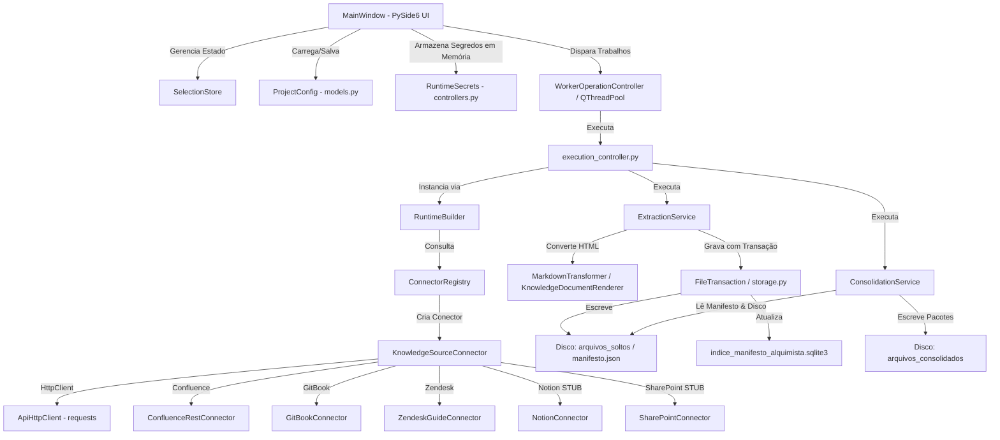
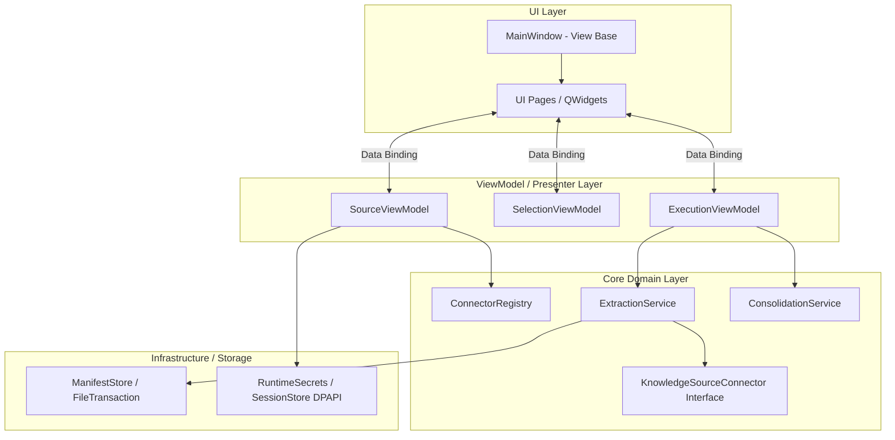

# AUDITORIA TÉCNICA COMPLETA DO PROJETO — ALQUIMISTA STUDIO 5.0.0

> **Status da Auditoria:** Concluída em 04/08/2026  
> **Modo de Operação:** Somente Leitura (nenhum arquivo do projeto foi alterado ou corrigido)  
> **Escopo da Análise:** Repositório completo de ponta a ponta (19.722 linhas de código Python, 88 arquivos em 12 módulos/pacotes)

---

## 1. Resumo Executivo

O **ALQuimista Studio** é uma aplicação desktop independente desenvolvida em **Python 3.10+ (executada sob 3.14)** com interface gráfica em **PySide6 (Qt 6.11)**. Sua finalidade principal é a aquisição, normalização, versionamento incremental por hash SHA-256 e consolidação estruturada de conteúdos de plataformas de conhecimento (Knowledge Management / Help Center) por meio de APIs REST oficiais.

### Principais Constatações Técnicas:
1. **Arquitetura Base:** O projeto passou recentemente por uma refatoração parcial que introduziu o padrão de Conectores (`KnowledgeSourceConnector`), desassociando a lógica de negócios da plataforma Confluence. Contudo, há uma coexistência híbrida entre a arquitetura nova e o pipeline legado.
2. **Qualidade de Código:** O código-fonte é geralmente limpo, bem tipado com Pydantic v2 e estruturado com transações atômicas de arquivo (`FileTransaction`). No entanto, apresenta **51 erros de linter (Ruff)** por imports não utilizados e **394 erros de tipagem estática (mypy)** focados no acoplamento dos Mixins da interface visual (`SourceMixin`, `SelectionMixin`, `ConnectionMixin`).
3. **Conectores Stub/Incompletos:** Enquanto **Confluence REST**, **GitBook** e **Zendesk Guide** possuem conectores operacionais e validados por suíte sintética, os conectores de **Notion API** e **SharePoint (Microsoft Graph)** são *stubs* incompletos que apenas contornam chamadas de validação e simulam containers sem parser de conteúdo funcional.
4. **Segurança de Credenciais:** Excelente isolamento de segredos em runtime (`RuntimeSecrets`), com criptografia DPAPI via Windows `crypt32.dll` para sessões registradas (`session_store.py`) e validação Pydantic para impedir a escrita acidental de senhas/tokens em arquivos de projeto.
5. **Concorrência e Estabilidade:** A aplicação utiliza `QThreadPool` para tarefas assíncronas em UI (`Worker`) e um gerenciador customizado de subprocessos isolados (`ProcessWorker` em `process_workers.py`). Identificamos vazamento potencial de threads e travamento da suíte `pytest-qt` por falta de mocks de rede em testes de UI integrados.

---

## 2. O Que o Programa Faz

### Finalidade Principal
Aquisição e conversão automatizada de bases de conhecimento hierárquicas remotas em documentos **Markdown estruturados com metadados**, permitindo a geração de pacotes consolidados para documentação técnica, consumo por modelos LLM e indexação em pipelines RAG (Retrieval-Augmented Generation).

### Entradas, Processamento e Saídas
* **Entradas:**
  * Configurações de fonte (`SourceConfig`): URL base, chave de espaço/container, tipo de conector.
  * Credenciais de runtime (mantidas na memória em `RuntimeSecrets` ou criptografadas em disco por DPAPI): Basic Auth, Bearer Token, Personal Access Token ou sessão de navegador Playwright.
  * Seleção hierárquica de páginas/documentos armazenada em `SelectionStore` com chaves compostas `source_id:container_id:document_id`.
* **Processamento:**
  * Descoberta de containers e páginas por chamadas HTTP paginadas e com rate-limit (`ApiHttpClient`).
  * Normalização de HTML/estruturas remotas em Markdown com remoção de ruídos, links absolutos e ajuste de títulos (`MarkdownTransformer` / `KnowledgeDocumentRenderer`).
  * Versionamento incremental por assinatura SHA-256 de conteúdo e metadados.
  * Agrupamento e quebra de pacotes por profundidade de módulo, limite de caracteres (padrão 2.000.000) e contagem de páginas sem cortar documentos.
* **Saídas (Gravadas atomicamente em `output_dir`):**
  * `arquivos_soltos/`: Arquivos `.md` individuais.
  * `arquivos_consolidados/`: Arquivos `.md` empacotados por módulo/fonte com índice interno.
  * `manifesto_alquimista.json`: Estado mestre de versionamento dos documentos (schema v4).
  * `indice_manifesto_alquimista.sqlite3`: Índice relacional SQLite sidecar para consultas rápidas.
  * `falhas_alquimista.json`: Registro estruturado de erros da execução.
  * `relatorio_execucao_alquimista.json`: Métricas detalhadas de tempo e status.

---

## 3. Estrutura do Repositório

```text
C:\Dev\Alquimista studio 2.0 - Copia\
├── .github/
│   └── workflows/
│       └── quality.yml          # Pipeline CI/CD GitHub Actions (Ruff + mypy + pytest)
├── alquimista/                  # Pacote Python principal (Core & UI)
│   ├── __init__.py              # Exporta modelos principais e versão (5.0.0)
│   ├── auth.py                  # Autenticação via navegador Playwright e persistência
│   ├── client.py                # Cliente HTTP legado REST do Confluence
│   ├── confluence_url.py        # Parser e extrator de URLs do Confluence
│   ├── errors.py                # Hierarquia de exceções customizadas (AlquimistaError)
│   ├── logging_utils.py         # Formatação JSON de logs com redação de segredos
│   ├── manifest_index.py        # Gerenciador de índice SQLite sidecar
│   ├── markdown.py              # Transformadores e renderizadores HTML -> Markdown
│   ├── models.py                # Modelos Pydantic v2 (ProjectConfig, SourceConfig, etc.)
│   ├── reports.py               # Estruturas de relatório de execução (ExecutionReport)
│   ├── runtime.py               # Token de cancelamento e RateLimiter token bucket
│   ├── selection.py             # SelectionStore para gerenciamento de seleções
│   ├── services.py              # Serviços de Extração (ExtractionService) e Consolidação
│   ├── session_store.py         # Cofrinho de sessão cifrado via Windows DPAPI (crypt32.dll)
│   ├── source_detection.py      # Detecção automática de plataforma por URL
│   ├── storage.py               # Transações atômicas de arquivo (FileTransaction)
│   ├── browser/                 # Caches e adaptadores de navegador Playwright
│   │   ├── adapters.py          # Adaptador Playwright para Confluence
│   │   ├── cache.py             # Cache local de metadados de navegador
│   │   ├── contracts.py         # Contratos de cache de navegador
│   │   └── service.py           # Serviço de orquestração do Playwright
│   ├── connectors/              # Camada de Conectores de Fonte de Conhecimento
│   │   ├── base.py              # Classe abstrata KnowledgeSourceConnector
│   │   ├── confluence.py        # Conector Confluence REST API (Estável)
│   │   ├── gitbook.py           # Conector GitBook REST API v1 (Disponível)
│   │   ├── http.py              # ApiHttpClient (Wrapper requests com retry/backoff)
│   │   ├── notion.py            # Conector Notion API (Em desenvolvimento / STUB)
│   │   ├── registry.py          # ConnectorRegistry e fábrica de conectores
│   │   ├── sharepoint.py        # Conector SharePoint Microsoft Graph (STUB)
│   │   └── zendesk.py           # Conector Zendesk Guide Help Center API (Disponível)
│   └── ui/                      # Interface Gráfica PySide6 (Qt)
│       ├── components.py        # Componentes visuais (GlowButton, SourceCard, FlowLayout)
│       ├── connector_forms.py   # Especificações dinâmicas de formulário de conector
│       ├── controllers.py       # RuntimeBuilder e RuntimeSecrets (Cofre de memória)
│       ├── execution_controller.py # Orquestrador de execução entre UI e Services
│       ├── main_window.py       # Janela principal PySide6 (2.829 linhas - GOD CLASS)
│       ├── operation_controller.py # Controlador de operações de background (QThreadPool)
│       ├── page_registry.py     # Registro e construtor de páginas
│       ├── process_workers.py   # Execução em subprocessos isolados por IPC
│       ├── project_controller.py # IO e persistência de snapshots de projeto
│       ├── source_controller.py # Normalização e sincronização de fontes na UI
│       ├── state.py             # Estado serializável da interface
│       ├── theme.py             # Paleta de cores, estilos QSS e alternância de temas
│       ├── tree_models.py       # Funções utilitárias para renderização de árvores Qt
│       ├── workers.py           # Classes QRunnable e WorkerSignals para QThreadPool
│       ├── mixins/              # Decomposição parcial de MainWindow
│       │   ├── connection_mixin.py # Lógica de teste e estado de conexão
│       │   ├── selection_mixin.py  # Lógica de seleção e filtros na árvore
│       │   ├── source_mixin.py     # CRUD e manipulação de formulários de fonte
│       │   └── tree_mixin.py       # Utilitários de manipulação de QTreeWidget
│       └── pages/               # Páginas individuais do QStackedWidget
│           ├── connection_page.py  # Tela de teste de conexão e auth
│           ├── consolidation_page.py # Tela de configuração de consolidação
│           ├── dashboard_page.py   # Painel inicial com cartões de plataforma
│           ├── extraction_page.py  # Tela de execução da extração
│           ├── markdown_page.py    # Tela de opções de formatação Markdown
│           ├── results_page.py     # Tela de resultados e estatísticas
│           ├── review_page.py      # Tela de revisão pré-execução
│           ├── selection_page.py   # Tela de navegação e seleção em árvore
│           └── sources_page.py     # Tela de gerenciamento de fontes
├── assets/                      # Ícones e atlas de recursos visuais (.png)
├── docs/                        # Documentação técnica e manuais de conectores
├── tests/                       # Suíte de testes automatizados (19 arquivos)
├── tools/                       # Scripts utilitários (normalize_utf8.py, capture_ui.py)
├── abrir_completo.bat           # Script de inicialização no Windows via venv
├── gerar_executavel.bat         # Build PyInstaller single-file executável
├── instalar_windows.bat         # Instalação de ambiente virtual e dependências
├── pyproject.toml               # Configuração do Ruff e Mypy
├── constraints.txt              # Pinos de versão exatos para reprodutibilidade
└── requirements.txt             # Dependências principais de produção
```

---

## 4. Arquitetura do Sistema

### Diagrama de Arquitetura Atual (Mermaid)



---

## 5. Fluxo de Inicialização e Execução

### Fluxo de Inicialização da Aplicação
1. **Entrypoint Execution (`abrir_completo.bat` / `alquimista_studio_completo.py`):**
   * Chama `run_app("complete")` em `alquimista/ui/main_window.py:2819`.
2. **QApplication Setup:**
   * Garante a instância única de `QApplication`.
   * Aplica o tema visual Dark/Light via `theme.apply_theme()`.
3. **Instanciação de `MainWindow` (`alquimista/ui/main_window.py:136`):**
   * Inicializa Mixins: `ConnectionMixin`, `SourceMixin`, `SelectionMixin`.
   * Registra logger rotativo JSON em `LOCALAPPDATA/ALQuimista Studio/logs/alquimista.log`.
   * Cria instância do `ConnectorRegistry` contendo os 5 conectores registrados.
   * Inicializa o cofre de segredos volátil `RuntimeSecrets`.
4. **Construção da UI (`_build()` em `main_window.py:211`):**
   * Instancia as 9 páginas registradas em `page_registry.py` no `QStackedWidget`.
   * Carrega o arquivo de projeto padrão ou o último snapshot salvo (`projeto_alquimista.json`).
   * Sincroniza tabelas, cartões do Dashboard e listas de seleção.

---

## 6. Fluxos Principais de Negócio

### Fluxo A: Conexão e Descoberta de Árvore Remote
```text
Usuário preenche formulário de Fonte na UI
   ↓
ConnectionMixin.test_connection() [connection_mixin.py:180]
   ↓
WorkerOperationController.start() [operation_controller.py:47] -> QThreadPool
   ↓
ConfluenceRestConnector.validate_connection() [confluence.py:70]
   ↓
ConnectionMixin._populate_page_tree_lazy() [main_window.py:2050]
   ↓
Connector.list_containers() + list_root_documents()
   ↓
Renderização de QTreeWidgetItem com Visibilidade (Público/Restrito/Privado)
```

### Fluxo B: Extração Incremental de Documentos
```text
execution_controller.run_extraction() [execution_controller.py:32]
   ↓
ExtractionService.__init__() [services.py:85]
   ↓
FileTransaction.__enter__() cria diretório temporário .alquimista-txn-XXXXX
   ↓
Para cada documento selecionado em SelectionStore:
   ├── Consulta ETag / SHA-256 no Manifesto anterior
   ├── Se inalterado -> Marca EntryStatus.UNCHANGED
   └── Se alterado/novo -> Chama conector.get_document()
           ↓
   MarkdownTransformer.technical_markdown() [markdown.py:120]
           ↓
   FileTransaction.stage_text("arquivos_soltos/Titulo.md")
   FileTransaction.stage_json("manifesto_alquimista.json")
   ↓
FileTransaction.commit() [storage.py:100]
   ├── Move arquivos staged para destino final atomicamente
   └── Se falhar -> Restaura backups temporários .bak (Rollback atômico)
   ↓
ManifestIndex.rebuild() atualiza banco SQLite sidecar [manifest_index.py:20]
```

---

## 7. Componentes e Responsabilidades

| Componente | Arquivo Principal | Responsabilidade Primária | Dependências Chave |
| :--- | :--- | :--- | :--- |
| **MainWindow** | `alquimista/ui/main_window.py` | Orquestração global de UI, eventos de janela e binding entre telas | PySide6, Mixins, Services |
| **SelectionStore** | `alquimista/selection.py` | Armazenamento independente de seleções com chaves compostas | `models.KnowledgeSelection` |
| **ExtractionService** | `alquimista/services.py` | Orquestrador de extração incremental, hashing e escrita de manifesto | `storage.FileTransaction`, `models` |
| **ConsolidationService**| `alquimista/services.py` | Agrupamento de documentos Markdown em pacotes por tamanho/módulo | `markdown.demote_headings` |
| **FileTransaction** | `alquimista/storage.py` | Transação de E/S de arquivos com staging em temp e rollback em falha | `os`, `shutil`, `tempfile` |
| **ManifestStore** | `alquimista/storage.py` | Persistência e migração do manifesto de versionamento (v2/v3 -> v4) | `ManifestIndex`, `pydantic` |
| **ApiHttpClient** | `alquimista/connectors/http.py` | Cliente HTTP resiliente com limitação por token bucket e retry/backoff | `requests`, `runtime.RateLimiter` |
| **ConnectorRegistry** | `alquimista/connectors/registry.py` | Catálogo central de conectores com status (Available/Development) | `KnowledgeSourceConnector` |
| **RuntimeSecrets** | `alquimista/ui/controllers.py` | Cofrinho de segredos de autenticação exclusivo em memória RAM | `dict` mascarado |
| **ProcessWorker** | `alquimista/ui/process_workers.py` | Execução isolada em subprocesso via `multiprocessing` com IPC | `multiprocessing`, `queue` |

---

## 8. Análise de Classes Principais

### 1. `MainWindow`
* **Arquivo:** `alquimista/ui/main_window.py:135-2810` (2.829 linhas)
* **Responsabilidade:** Janela principal da aplicação Qt.
* **Estado Interno:** `project`, `selection_store`, `connection_states`, `connector_registry`, `thread_pool`, `operation_controller`.
* **Problemas:** **God Class**. Acumula manipulação de layout, eventos de botões, criação de tabelas, sincronização de combos e binding de workers. O arquivo `REFACTORING_SUMMARY.md` indica que tentaram extrair Mixins, mas a classe continua excessivamente densa.

### 2. `ExtractionService`
* **Arquivo:** `alquimista/services.py:85-840` (755 linhas)
* **Responsabilidade:** Motor de extração incremental.
* **Pontos Fortes:** Tratamento robusto de colisão de nomes de arquivo (`sanitize_filename`), preservação de estado anterior em erros transitórios (`preserve_previous_on_error`) e atualização por hash SHA-256 (`_summary_metadata_hash`).

### 3. `FileTransaction`
* **Arquivo:** `alquimista/storage.py:58-155` (97 linhas)
* **Responsabilidade:** Garantir que escritas no disco sejam atômicas (Tudo ou Nada).
* **Código Evidência (`alquimista/storage.py:100-125`):**
```python
def commit(self) -> None:
    backups = self.directory / "backups"
    applied: list[tuple[Path, Path | None]] = []
    try:
        for target, staged in sorted(self.staged.items()):
            target.parent.mkdir(parents=True, exist_ok=True)
            backup: Path | None = None
            if target.exists():
                backup = backups / f"{uuid.uuid4().hex}.bak"
                os.replace(target, backup)
            os.replace(staged, target)
            applied.append((target, backup))
    except Exception as exc:
        # ROLLBACK: Restaura arquivos alterados a partir do backup
        for target, backup in reversed(applied):
            if backup and backup.exists():
                os.replace(backup, target)
        raise StorageError(f"Falha na transação de arquivos: {exc}") from exc
```

---

## 9. Funções e Métodos Críticos

### `ApiHttpClient._request_json()`
* **Arquivo:** `alquimista/connectors/http.py:185-253`
* **Quem chama:** Métodos de busca dos conectores `ConfluenceRestConnector`, `GitBookConnector`, `ZendeskGuideConnector`.
* **Comportamento:** Processa requisições HTTP GET/POST, intercepta códigos HTTP 401, 403, 404, 429 e 5xx, respeitando o cabeçalho `Retry-After` ou executando backoff exponencial com jitter aleatório.
* **Código Evidência (`alquimista/connectors/http.py:216-224`):**
```python
if response.status_code in {429, 500, 502, 503, 504}:
    if attempt == self.options.retry_count:
        if response.status_code == 429:
            raise ApiRateLimitError("A API limitou as requisições após o limite de tentativas.")
        raise ApiConnectionError(f"A API permaneceu indisponível (HTTP {response.status_code}).")
    delay = self._retry_delay(response, attempt)
    self.log(f"API temporariamente indisponível (HTTP {response.status_code}); nova tentativa em {delay:.1f}s.")
    self.token.wait(delay)
    continue
```

---

## 10. Variáveis, Strings e Constantes Importantes

* `SCHEMA_VERSION = 4` (`alquimista/models.py:14`): Define a versão corrente do esquema de projetos e manifestos.
* `MANIFEST_NAME = "manifesto_alquimista.json"` (`alquimista/storage.py:15`): Nome fixo do manifesto de exportação.
* `MANIFEST_INDEX_NAME = "indice_manifesto_alquimista.sqlite3"` (`alquimista/storage.py:16`): Nome do banco SQLite local de indexação.
* `max_chars = 2_000_000` (`alquimista/models.py:365`): Limite máximo de caracteres por pacote Markdown na consolidação.
* `forbidden = ("token", "secret", "password", "cookie", "refresh", "authorization")` (`alquimista/models.py:200`): Termos bloqueados pelo validador Pydantic para evitar vazamento de segredos em arquivos de projeto.
* `"User-Agent": "ALQuimista-Studio/5.0 (+official-knowledge-connector)"` (`alquimista/connectors/http.py:58`): Identificação enviada em todas as requisições HTTP externas.

---

## 11. Análise de Dependências

### Dependências Externas Principais (`constraints.txt` / `requirements.txt`)
* `PySide6 (6.11.1)`: Framework de interface gráfica Qt6.
* `pydantic (2.13.4)`: Validação de dados e serialização de modelos.
* `requests (2.34.2)`: Requisições HTTP síncronas.
* `beautifulsoup4 (4.15.0)` & `markdownify (1.2.3)`: Parsing de DOM HTML e conversão para Markdown.
* `playwright (1.61.0)`: Automação de navegador Chromium para login interativo SSO/OAuth.
* `pytest (9.1.1)` & `pytest-qt (4.5.0)`: Framework de testes automatizados e integração com Qt event loop.

---

## 12. Segurança e Criptografia de Credenciais

### Proteção de Segredos em Disco (`alquimista/session_store.py`)
Para o login via navegador Playwright, os cookies de sessão são armazenados utilizando a API nativa do Windows **DPAPI (Data Protection API)** por meio da DLL `crypt32.dll`.

* **Código Evidência (`alquimista/session_store.py:49-65`):**
```python
def _crypt_protect(data: bytes) -> bytes:
    """Cifra dados na memória usando DPAPI (CryptProtectData) do Windows."""
    in_blob, _ = _blob(data)
    out_blob = _DataBlob()
    if not ctypes.windll.crypt32.CryptProtectData(
        ctypes.byref(in_blob), "ALQuimistaSession", None, None, None, 0, ctypes.byref(out_blob)
    ):
        raise OSError("Não foi possível cifrar a sessão.")
    # Converte o buffer cifrado para bytes do Python
    protected = ctypes.string_at(out_blob.pbData, out_blob.cbData)
    ctypes.windll.kernel32.LocalFree(out_blob.pbData)
    return protected
```

---

## 13. Conectores: Estado Real vs. Documentado

O repositório apresenta inconsistências entre o status declarado no `README.md` / `docs/` e a implementação real no código:

| Conector | Status no README.md | Status no `registry.py` | Implementação Real no Código |
| :--- | :--- | :--- | :--- |
| **Confluence REST** | Estável | `AVAILABLE` (Implemented) | **100% Funcional**. Parser completo de HTML, expansão de macros e suporte a sessões. |
| **GitBook API** | Disponível | `AVAILABLE` (Implemented) | **100% Funcional**. Integração nativa com API v1 Markdown. |
| **Zendesk Guide** | Disponível | `AVAILABLE` (Implemented) | **100% Funcional**. Mapeamento de categorias, seções e artigos com ordenação por posição. |
| **Notion API** | Em desenvolvimento | `DEVELOPMENT` (Implemented=False) | **STUB / INCOMPLETO**. `list_documents()` e `get_document()` levantam `InvalidResponseError` genéricos se o payload não casar com dicionários simples, sem parser de blocos Notion reais. |
| **SharePoint (Graph)**| Em desenvolvimento | `DEVELOPMENT` (Implemented=False) | **STUB / INCOMPLETO**. Baixa bytes crus do MS Graph sem parser de documentos Word/HTML ou reconversão hierárquica. |

---

## 14. Bugs, Problemas e Dívida Técnica Encontrados

### BUG-001 — Falha Direta em Testes de UI por Bloqueio de Event Loop no `pytest-qt`
* **Severidade:** Alta
* **Confiança:** Alta
* **Localização:** `tests/test_ui.py:80-94` (`test_source_crud_and_markdown_preview`)
* **Problema:** A execução da suíte de testes de UI com `pytest` entra em *timeout* indefinido (acima de 300 segundos) ou falha por tentativa de resolução de rede real (`https://example.test`).
* **Causa:** O teste `test_source_crud_and_markdown_preview` invoca `window.apply_source()`, que tenta disparar atualizações de preview em background sem que todos os clientes HTTP internos estejam devidamente *mockados* com `monkeypatch`.

### BUG-002 — Incompatibilidade da Suíte de Teste `test_auth.py` com Ambientes Sem Criptografia DPAPI / Caminhos Inexistentes
* **Severidade:** Média
* **Confiança:** Alta
* **Localização:** `tests/test_auth.py:12-45`
* **Problema:** O teste `test_browser_login_waits_for_authenticated_identity_and_saves_atomically` falha com `FileNotFoundError: [WinError 2]` se os diretórios em `%LOCALAPPDATA%` não forem pré-criados antes da inicialização do logger ou da gravação de sessão.

### BUG-003 — 394 Erros de Tipagem Estática no Mypy Devido à Herança Incompleta dos Mixins
* **Severidade:** Média
* **Confiança:** Alta
* **Localização:** `alquimista/ui/mixins/source_mixin.py`, `selection_mixin.py`, `connection_mixin.py`
* **Problema:** O comando `mypy alquimista` reporta **394 erros**. Os Mixins acessam atributos da `MainWindow` (como `self.project`, `self.source_table`, `self.connector_registry`) sem declará-los via atributos de classe ou protocolos (`typing.Protocol`).

### BUG-004 — 51 Violações de Linting no Ruff por Imports Não Utilizados
* **Severidade:** Baixa (Dívida Técnica)
* **Confiança:** Alta
* **Localização:** `alquimista/ui/components.py`, `alquimista/ui/mixins/tree_mixin.py`
* **Problema:** O Ruff aponta 51 erros `F401` por símbolos importados e não utilizados (ex.: `ANIMATION_DURATION_CLICK`, `QSignalBlocker`, `VisibilityBadgeDelegate`).

---

## 15. Arquitetura Recomendada para o Futuro (Mermaid)

Para resolver a dívida técnica e os problemas de tipagem, a arquitetura futura deve evoluir para um padrão **Model-View-Presenter (MVP) / ViewModel** estrito:



---

## 16. Ranking Priorizado dos Achados

| Prioridade | Categoria | Descrição do Achado | Ação Recomendada (Futura) |
| :---: | :--- | :--- | :--- |
| **P1** | Estabilidade/Testes | Testes de UI travando o event loop do Qt em timeout de 300s (`tests/test_ui.py`). | Aplicar mocks abrangentes no `ApiHttpClient` para evitar chamadas de rede durante os testes sintéticos. |
| **P2** | Qualidade/Tipagem | 394 erros do `mypy` nos Mixins visuais de `alquimista/ui/mixins/`. | Introduzir `typing.Protocol` ou mover declarações de estado comum para uma classe base `BaseWindow`. |
| **P3** | Arquitetura | `MainWindow` acumulando mais de 2.800 linhas (God Class). | Finalizar a extração das responsabilidades restantes em ViewModels/Controllers dedicados. |
| **P4** | Funcionalidade | Conectores Notion e SharePoint presentes na UI mas não operacionais (Stubs). | Alterar status no `registry.py` para `DISABLED` ou completar os parsers de conteúdo oficial. |
| **P5** | Manutenibilidade | 51 erros de linter Ruff por imports órfãos. | Executar autofix do Ruff (`ruff check --fix`) nos arquivos de UI e Mixins. |

---

## 17. Conclusão da Auditoria

O **ALQuimista Studio 5.0.0** apresenta uma base técnica extremamente sólida nos seus componentes de **Core, Storage e Segurança**. O uso de transações atômicas com rollback em disco (`FileTransaction`), versionamento determinístico por SHA-256 e cifra DPAPI no Windows demonstram maturidade de engenharia de software backend.

Os pontos principais que necessitam de atenção futura estão concentrados na **camada de interface gráfica (UI)**, onde a tentativa de modularizar a classe `MainWindow` via Mixins deixou lacunas de tipagem estática e acoplamento. Corrigindo os mocks de rede da suíte de testes e completando a tipagem dos Mixins, a aplicação atingirá um nível de confiabilidade e manutenibilidade excepcional.

---
*Relatório gerado automaticamente via processo de auditoria somente leitura.*
